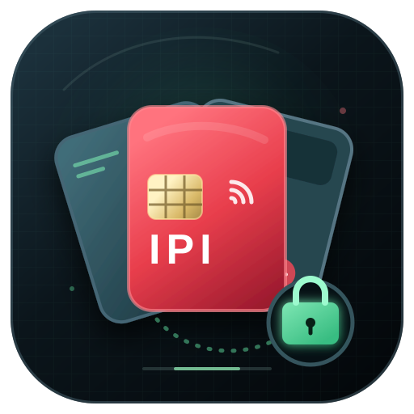

<p align="center">
  <a href="#ipi-card-vault--shared-wallet-for-multiple-cards"></a>
  &nbsp;&nbsp;&nbsp;&nbsp;
  <a href="#ipi-payment-relay--five-hop-payment-forwarding"></a>
</p>

<h1 align="center">IPI Wallet Multicards</h1>

<p align="center">
  <strong>Multiple cards. One vault. Five relays.</strong><br>
  Deployment-ready CosmWasm contracts for the shared IPI Wallet.
</p>

---

`ipi-wallet-multicards` is a repository of CosmWasm contracts used by IPI
Wallet to operate a single wallet through multiple physical cards and to
forward payments through a layer of five relays.

The repository contains the source code of both contracts, locked dependency
versions, tests, deployment records, and ready-to-use optimized Wasm artifacts
with checksums. It does not contain the desktop application, card firmware, or
the card issuance process. It is not a server-side service either: an operator
stores an artifact on a selected chain, after which the contract runs directly
on that chain. The `ipi-wallet` application uses a verified, network-specific
`code_id`.

> **Security status:** this is unaudited laboratory software. It should not be
> used to protect funds of significant value.

## Repository contents

| Component | File | Size | SHA-256 |
| --- | --- | ---: | --- |
| IPI Card Vault | `contracts/multicarding/ipi_card_vault.wasm` | 228947 B | `fcb5a4653163ca4e3613390bb93c009da1fc49541db21bb11fdea5f64bfec454` |
| IPI Payment Relay | `contracts/anonymization/ipi_payment_relay.wasm` | 236954 B | `3ce3c4124544daf100f483110be4c5c9093d4f035fe14259bd2e3ceaef761553` |

Key directories:

```text
card-vault/
├── Cargo.toml
└── src/                     # IPI Card Vault source code
payment-relay/
├── Cargo.toml
├── src/                     # IPI Payment Relay source code
└── tests/                   # full-route integration tests
Cargo.toml                   # shared workspace for both contracts
Cargo.lock                   # shared dependency lockfile
contracts/
├── multicarding/
│   ├── ipi_card_vault.wasm
│   └── checksums.txt
└── anonymization/
    ├── ipi_payment_relay.wasm
    └── checksums.txt
deployments/                 # recorded and template deployment data
```

Verify file integrity before every deployment:

```sh
(cd contracts/multicarding && sha256sum --check checksums.txt)
(cd contracts/anonymization && sha256sum --check checksums.txt)
```

Do not deploy an artifact if its checksum differs. The artifacts were built for
CosmWasm 2.x. The target network must support `cosmwasm_2_0`, the native `aipi`
denomination, protobuf `Any` messages, and the `feegrant` module.

## Building and testing

The project uses Rust `1.85.0`, as specified in `rust-toolchain.toml`. Both
contracts are peer packages in a single workspace and can be checked
independently:

```sh
cargo test --locked -p ipi-card-vault
cargo test --locked -p ipi-payment-relay
cargo clippy --locked -p ipi-card-vault --all-targets -- -D warnings
cargo clippy --locked -p ipi-payment-relay --all-targets -- -D warnings
```

CI also builds both `wasm32-unknown-unknown` targets, reproduces the optimized
artifacts with `cosmwasm/optimizer:0.16.1`, and compares their bytes with the
files in `contracts/`.

## IPI Card Vault — shared wallet for multiple cards

Card Vault is a contract that holds funds and serves as the wallet's shared
receiving address. Each attached card retains its own private key and controller
address. The contract does not store card keys.

The authorization model is full **one-of-N**, not threshold multisig:

- the card that creates the vault becomes its first member but receives no
  owner role or other special privileges;
- each active card can independently transfer funds from the vault, invite
  another card, cancel any pending invitation, and remove any active card,
  including itself;
- an invited card must accept the invitation with a transaction signed by its
  own key;
- the last active card cannot be removed;
- an invitation belongs to the entire vault, not only to the card that created
  it.

Each active card receives a vault-funded fee grant restricted to
`/cosmwasm.wasm.v1.MsgExecuteContract` messages. An invited, previously unused
address receives `1 aipi` and the restricted fee grant needed to accept the
invitation. Canceling an invitation or removing a card revokes the corresponding
fee grant.

At instantiation, the contract accepts only `aipi`; any funds sent at that time
become the vault balance. Execute calls do not accept attached funds. A transfer
amount must be positive and is always denominated in `aipi`.

### Instantiation

The code should have the `Everybody` instantiate permission, and every instance
must be created without an administrator. The instantiate message is empty:

```json
{}
```

The transaction sender becomes the first active card. Omitting an administrator
is intentional: it prevents the instance code from being replaced later through
migration.

### Execute messages

```json
{"invite_card":{"address":"ipi1..."}}
{"accept_invitation":{}}
{"cancel_invitation":{"address":"ipi1..."}}
{"remove_card":{"address":"ipi1..."}}
{"transfer":{"recipient":"ipi1...","amount":"123"}}
```

`amount` is an integer encoded as a string. Invitation, cancellation, removal,
and transfer operations are subject to the membership controls described above.

### Queries

```json
{"config":{}}
{"member":{"address":"ipi1..."}}
{"members":{"start_after":null,"limit":30}}
{"invitation":{"address":"ipi1..."}}
{"invitations":{"start_after":null,"limit":30}}
```

`config` returns the denomination and active card count. Single-item queries
return a member or invitation if it exists. Lists are paginated by address; the
default limit is 30 and the maximum is 100.

## IPI Payment Relay — five-hop payment forwarding

Payment Relay separates the Card Vault address from the address shown as the
direct sender of the final bank transfer. For each vault, the wallet creates five
separate, immutable instances of the same code with unique slots `0..4`. Each
instance is associated with one Card Vault, stores no key, and retains no balance
after a valid payment.

A typical payment prepared by `ipi-wallet` is a single atomic transaction:

1. Card Vault transfers the exact amount to an active card controller.
2. The controller transfers it to the first of five relays.
3. All five relays forward the full amount in a random order.
4. The final relay sends the full amount to the recipient.

The first relay requires exactly four further unique instances. Each must have
the same `code_id`, have no administrator, belong to the same vault, and
represent a different slot. If any stage fails, the entire transaction is rolled
back.

### Privacy limitation

Payment Relay **does not provide cryptographic anonymity** and is not a mixer.
The chain publicly reveals the vault, controller, amount, recipient, payment ID,
and complete route. The mechanism only reduces the simple, direct association
between the vault address and the sender shown in the recipient's basic
interface. Anyone analyzing chain data can reconstruct the route.

### Instantiation

The artifact is stored on-chain only once, with the `Everybody` permission. For
each vault, an active controller creates five instances without an administrator:

```json
{"vault":"ipi1...","slot":0}
```

Repeat the operation for slots `1`, `2`, `3`, and `4`. The contract rejects
funds during instantiation, an out-of-range slot, and any attempt made by an
address that is not an active member of the specified Card Vault.

Configuration query:

```json
{"config":{}}
```

It should return the correct `vault`, a unique `slot`, `denom: "aipi"`, and
`relay_count: 5`.

### Payment forwarding

```json
{
  "forward": {
    "controller": "ipi1...",
    "route": ["ipi1relay...", "ipi1relay...", "ipi1relay...", "ipi1relay..."],
    "recipient": "ipi1...",
    "payment_id": "0000000000000000000000000000000000000000000000000000000000000000"
  }
}
```

The first call must come from an active controller, include exactly the other
four relays, and transfer exactly one positive `aipi` coin. `payment_id` must be
a 64-character lowercase hexadecimal value. Subsequent calls may only come from
matching relay instances. The balance of every instance should be zero after a
valid payment.

## Recorded deployment status

IPI Card Vault has been verified on `ipi-testnet-1`:

- `code_id`: `2`;
- code storage transaction:
  `3116E3BAC8EA64DCDCBE7FAB78B42E75C2DEED63F07A8BD2E71893174832438F`;
- test contract:
  `ipi1nc5tatafv6eyq7llkr2gv50ff9e22mnf70qgjlv737ktmt4eswrq5df8fy`;
- instance administrator: none;
- on-chain code SHA-256:
  `fcb5a4653163ca4e3613390bb93c009da1fc49541db21bb11fdea5f64bfec454`.

Payment Relay has no confirmed deployment on `ipi-testnet-1` recorded in this
repository. The feature should remain disabled in the application until at
least the following have been recorded and independently verified: the store
transaction, on-chain SHA-256, `code_id`, `Everybody` permission, absence of an
administrator, and a complete five-instance test.

The identifiers above apply only to `ipi-testnet-1`. A `code_id`, transaction
hash, or contract address is not portable between Testnet and Mainnet. A Mainnet
deployment requires storing and verifying both artifacts again and configuring
the wallet with identifiers obtained from Mainnet.

## Minimum deployment verification

Before making a contract available to the application, the operator should:

1. use a synchronized node and a separate, funded operational account;
2. verify the chain ID, `aipi` denomination, runtime capabilities, and local
   SHA-256;
3. store the exact Git-tracked Wasm artifact with the `Everybody` permission;
4. wait for transaction confirmation and verify execution code `0`;
5. retrieve the code information and compare the on-chain SHA-256 with
   `checksums.txt`;
6. create a test instance without an administrator and verify its configuration;
7. for Card Vault, verify the first member and restricted fee grant;
8. for Payment Relay, verify all five slots, the complete route, an exact
   increase in the recipient's balance, and zero balances on all relays;
9. provide the application only with `code_id` values verified for the correct
   network.

Do not use a validator consensus key or deploy a locally rebuilt, untracked
artifact.

## Key security implications

- Losing one active card together with its credentials may result in the loss
  of the entire shared balance. Adding a card creates another complete
  authorization path.
- Instances without an administrator cannot be upgraded through migration. A
  new version requires new code and new instances.
- The `aipi` denomination is hard-coded in the contracts. Changing the network
  denomination requires a new artifact.
- Payment Relay data is public and allows the payment to be traced completely.
- The relay has no fund recovery function. `aipi` sent to its address through a
  regular transfer instead of `forward` may remain there permanently.

## License

The source code and artifacts are licensed under the Apache License 2.0. See
[`LICENSE`](LICENSE) for details.
